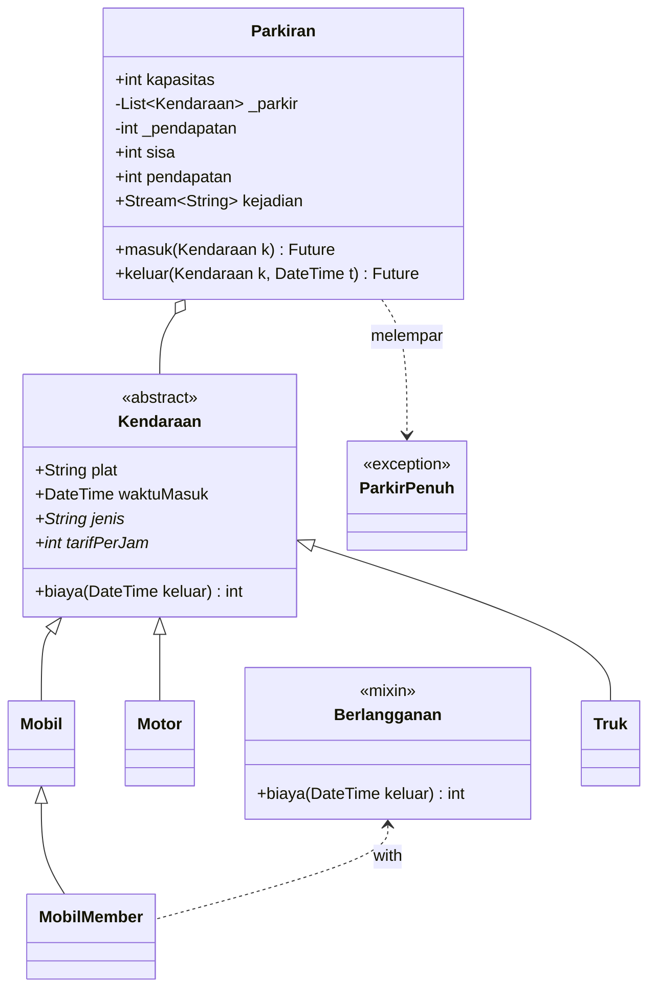
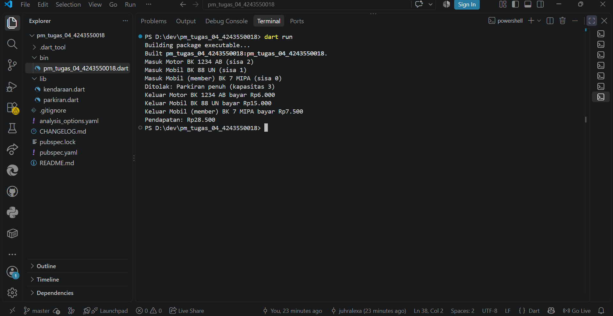

# Tugas Rutin 4: Sistem Parkir Kampus (Console)

## Identitas
- Nama: Juhraini Helfiana Lexa
- NIM: 4243550018
- Kelas: PSIK C
- Mata kuliah: Pemrograman Mobile 
- Program Studi Ilmu Komputer, Universitas Negeri Medan

## Diagram Kelas


## Keluaran Program


## Penjelasan
Enkapsulasi diterapkan pada kelas `Parkiran`: daftar kendaraan `_parkir`, `_pendapatan`, dan `_kejadian` bersifat privat, sehingga hanya bisa diubah lewat method `masuk` dan `keluar`. Akses dari luar disediakan lewat getter `sisa` dan `pendapatan`. Polimorfisme terlihat pada `List<Kendaraan>` yang berisi `Motor`, `Mobil`, dan `MobilMember`; pemanggilan `biaya()` menjalankan versi milik objek aslinya, termasuk diskon 50% dari mixin `Berlangganan`. Async diterapkan pada `masuk` dan `keluar` yang memakai `Future.delayed` untuk mensimulasikan palang otomatis dan dipanggil dengan `await` di `main`. Setiap kejadian dipancarkan lewat `StreamController.broadcast()` dan ditampilkan oleh listener di layar pos jaga. Kapasitas penuh ditangani dengan exception kustom `ParkirPenuh`.

## Cara Menjalankan
```
dart pub get
dart run
```

## Pernyataan Penggunaan AI
Saya menggunakan Claude (Anthropic) sebagai asisten belajar selama mengerjakan tugas ini, yaitu untuk membantu menyusun struktur kode, memperbaiki error saat menjalankan program, dan menyusun draf README. Kode sudah saya jalankan sendiri, hasilnya saya periksa dengan `dart run` dan `dart analyze`, dan saya memahami cara kerja setiap bagiannya.